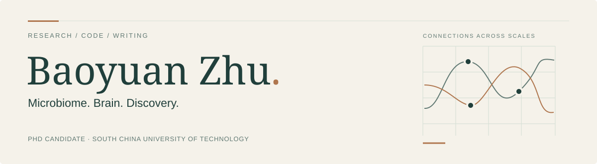
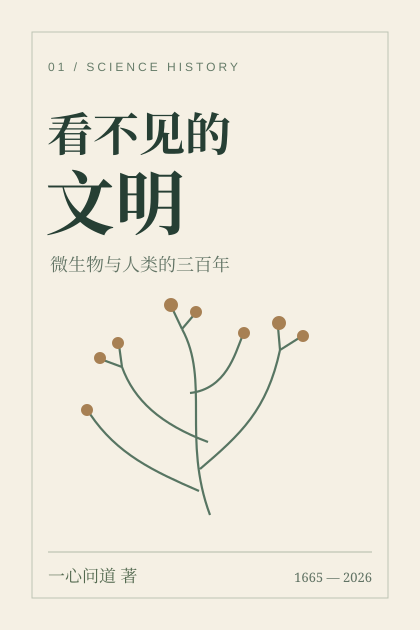
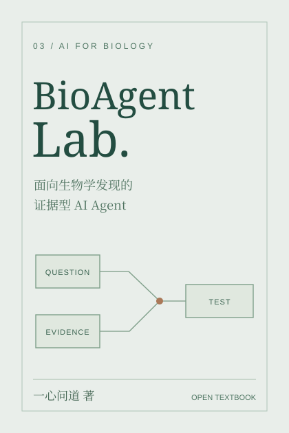
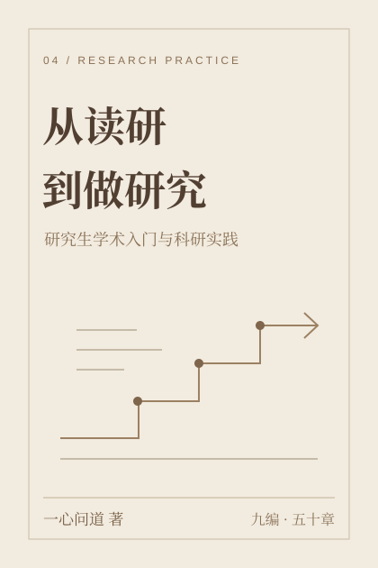

<a href="README.md">中文</a> &nbsp; / &nbsp; <strong>English</strong>

<picture>
  <source media="(max-width: 640px) and (prefers-color-scheme: dark)" srcset="assets/profile-mobile-dark.svg">
  <source media="(max-width: 640px)" srcset="assets/profile-mobile-light.svg">
  <source media="(prefers-color-scheme: dark)" srcset="assets/profile-dark.svg">
  
</picture>

### Baoyuan Zhu · 朱宝圆

**PhD candidate · South China University of Technology**

I study the connections between microbial ecosystems and brain function through metagenomics, multi-omics and interpretable computation. Beyond research, I write science-history novels and educational books as **一心问道**, exploring both scientific ideas and the people behind them.

> Questions in research. Perspective in writing.

<a href="https://zbyloveyj.github.io/about.html"><strong>Personal introduction ↗</strong></a> &nbsp; · &nbsp; <a href="https://zbyloveyj.github.io/">Academic website</a> &nbsp; · &nbsp; <a href="#books">Books</a> &nbsp; · &nbsp; <a href="#research">Research</a> &nbsp; · &nbsp; <a href="#publications">Publications</a> &nbsp; · &nbsp; <a href="#projects">Projects</a>

## 01 / Books & writing

Two science-history novels, an AI-agent textbook and a practical research handbook. All four books are written in Chinese.

<table width="100%">
<tr><td width="112" align="center" valign="middle"></td><td valign="middle">Science-history novel <strong>The Invisible Civilization</strong> 6 volumes · 48 chapters
Three centuries of microbiology, told through the lives of ordinary people—from early microscopy to cities, hospitals and laboratories.
<a href="https://zbyloveyj.github.io/invisible-civilization/"><strong>Read online →</strong></a> &nbsp; · &nbsp; <a href="https://zbyloveyj.github.io/invisible-civilization/contents.html">Contents</a></td></tr>
<tr><td width="112" align="center" valign="middle"></td><td valign="middle">Neuroscience novel <strong>Before We Understood the Brain</strong> 6 parts · 24 chapters · 81 illustrations
A doctoral student steps into a century of neuroscience, discovering the people, choices and everyday lives behind the experiments.
<a href="https://zbyloveyj.github.io/brain-novel/"><strong>Read online →</strong></a> &nbsp; · &nbsp; <a href="https://zbyloveyj.github.io/brain-novel/downloads/brain-novel-complete.pdf">Illustrated PDF</a></td></tr>
<tr><td width="112" align="center" valign="middle"></td><td valign="middle">AI for biology <strong>BioAgentLab</strong> Open textbook · Reproducible code
Evidence-grounded agents, hypothesis evaluation and reproducible computational practice for biological discovery.
<a href="https://github.com/zbyloveyj/BioAgentLab"><strong>Textbook & code →</strong></a></td></tr>
<tr><td width="112" align="center" valign="middle"></td><td valign="middle">Research field guide <strong>From Graduate Study to Research</strong> 9 parts · 50 chapters · Complete manuscript
A practical guide to graduate study, literature, research design, data analysis, academic writing and professional development.
<a href="https://zbyloveyj.github.io/graduate-research-handbook/"><strong>Read online →</strong></a> &nbsp; · &nbsp; <a href="https://zbyloveyj.github.io/graduate-research-handbook/downloads/complete-book.pdf">Complete PDF</a></td></tr>
</table>

Creative and educational work, separate from peer-reviewed publications. The neuroscience novel uses its official website cover; the other thumbnails are profile catalog designs.

## 02 / Research

**Microbial ecology** · Large-scale metagenomics, continuous ecological factors and community heterogeneity.  
**Brain–gut associations** · Psychiatric disorders, clinical cognition and functional neuroimaging.  
**Microbial genetics** · Genetic variation, horizontal gene transfer and functional remodeling.  
**AI for biology** · Multimodal integration, interpretable learning and normative modeling.

## 03 / Selected publications

**Advanced Science · 2026**  
[Dissecting the Ecological Structure of Health and Disease in the Global Gut Microbiome](https://doi.org/10.1002/advs.202517087)  
Global gut microbiome · Continuous ecological structure

**Research · 2026**  
[The Brain–Gut Health Initiative (BIGHI): A Prospective Cohort on Psychiatric Disorders in China](https://doi.org/10.34133/research.1142)  
Brain–Gut Health Initiative · Multimodal prospective cohort

<strong>Two more selected publications</strong>

**Journal of Affective Disorders · 2026**  
[Integrative multi-kingdom gut microbiome analysis uncovers clinical signatures of major depressive disorder](https://doi.org/10.1016/j.jad.2026.121858)

**Translational Psychiatry · 2025**  
[Multi-kingdom microbial changes and their associations with the clinical characteristics in schizophrenia patients](https://doi.org/10.1038/s41398-025-03449-6)

[Full publication list and citations →](https://zbyloveyj.github.io/publications.html)

## 04 / Open projects

[**MEF**](https://github.com/zbyloveyj/SCUT_Minilab_MEF) · Microbial ecological factors and continuous ecosystem modeling.  
[**CLEAR-Microbiome**](https://github.com/zbyloveyj/CLEAR-Microbiome) · Shared and specific cross-modal representations.  
[**Normative Microbial Networks**](https://github.com/zbyloveyj/Normative-Microbial-Network-Modeling-Framework) · Healthy-reference networks and ecological deviations.  
[**Microbiome Stability Atlas**](https://github.com/zbyloveyj/gut-microbiome-stability-variability-atlas) · Community stability and variation.  
[**BioAgentLab**](https://github.com/zbyloveyj/BioAgentLab) · Research agents and open education.

Research and educational code, not clinically validated software.

## 05 / Beyond the lab

I enjoy science history, writing and sharing knowledge. I am happily in a relationship and value our everyday life together, beyond the lab.

**Personal Growth Lab** is my independent personal-skills learning project. Its first track, [21-day Speaking & Communication Practice](https://zbyloveyj.github.io/personal-growth-lab/), includes self-paced lessons, recordings, scoring and progress logs.

---

<a href="https://zbyloveyj.github.io/"><strong>Academic website</strong></a> &nbsp; · &nbsp; <a href="https://orcid.org/0009-0006-6213-214X">ORCID</a> &nbsp; · &nbsp; <a href="mailto:18851970329@163.com">Contact</a> Baoyuan Zhu · 一心问道 &nbsp; / &nbsp; Research, code &amp; writing

