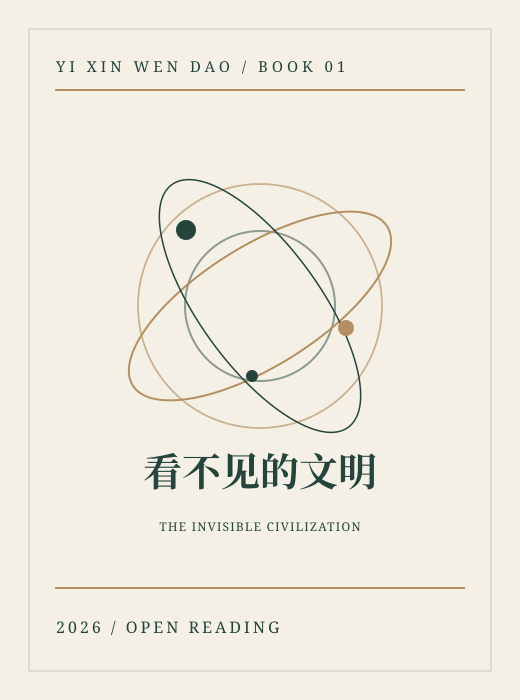
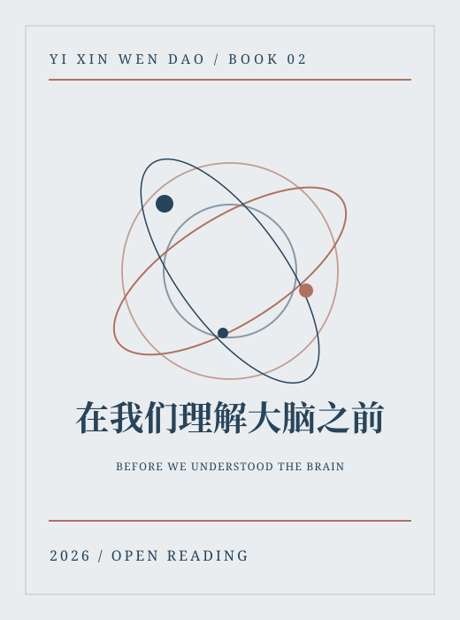
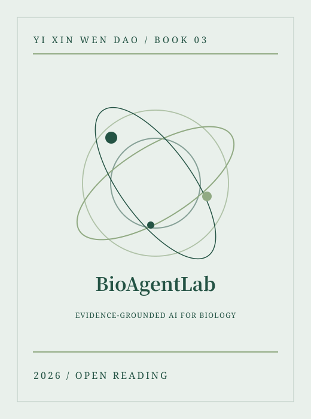
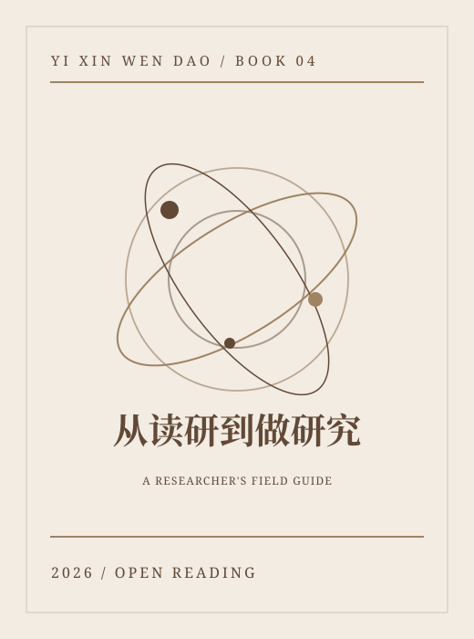

<!--
  Official GitHub Profile README · Baoyuan Zhu / 朱宝圆
  Editorial layout, bilingual content, light/dark-responsive banner.
  The abstract artwork is decorative and does not represent empirical data.
-->

  <picture>
    <source media="(max-width: 650px) and (prefers-color-scheme: dark)" srcset="assets/cover-mobile-dark.svg" />
    <source media="(max-width: 650px)" srcset="assets/cover-mobile-light.svg" />
    <source media="(prefers-color-scheme: dark)" srcset="assets/cover-dark.svg" />
    
  </picture>

  <a href="https://zbyloveyj.github.io/"><strong>Academic website</strong></a>
  &nbsp;·&nbsp;
  <a href="https://zbyloveyj.github.io/research.html">Research</a>
  &nbsp;·&nbsp;
  <a href="https://zbyloveyj.github.io/publications.html">Publications</a>
  &nbsp;·&nbsp;
  <a href="https://zbyloveyj.github.io/projects.html">Open science</a>
  &nbsp;·&nbsp;
  <a href="https://zbyloveyj.github.io/assets/Baoyuan_Zhu_Academic_CV.pdf">CV ↓</a>

<h2 align="center">Hello, I'm Baoyuan Zhu · 你好，我是朱宝圆</h2>

<strong>PhD Candidate · South China University of Technology</strong> 
Microbial Ecology · Brain–Gut Axis · Computational Biology · AI for Science

研究生命系统中看不见的联系：从微生物生态到脑功能，从多组学数据到可解释人工智能。 Exploring reproducible connections between microbial ecosystems, brain function and human health.

<a href="#books--四本著作">Books</a> · <a href="#research--研究方向">Research</a> · <a href="#selected-publications--代表论文">Publications</a> · <a href="#open-source--开源项目">Projects</a>

---

## Books / 四本著作

以 <strong>一心问道</strong> 为笔名，持续写作科学历史小说与开放教材。 Science writing, neuroscience narratives and open research education.

<table><tr><td width="50%" align="center" valign="top"> <strong>看不见的文明</strong> 六卷48章 · 微生物科学历史小说 <a href="https://zbyloveyj.github.io/invisible-civilization/"><strong>阅读作品 ↗</strong></a></td><td width="50%" align="center" valign="top"> <strong>在我们理解大脑之前</strong> 六部24章 · 81幅随文插图 <a href="https://zbyloveyj.github.io/brain-novel/"><strong>阅读作品 ↗</strong></a></td></tr><tr><td width="50%" align="center" valign="top"> <strong>BioAgentLab</strong> 面向生物学发现的证据型 AI Agent 教材 <a href="https://github.com/zbyloveyj/BioAgentLab"><strong>阅读作品 ↗</strong></a></td><td width="50%" align="center" valign="top"> <strong>从读研到做研究</strong> 研究生学术入门与科研实践手册 · 持续更新 <a href="https://zbyloveyj.github.io/graduate-research-handbook/"><strong>阅读作品 ↗</strong></a></td></tr></table>

封面为本主页制作的统一视觉示意，不替代各书正式出版封面。文学创作与开放教材不等同于同行评议论文。

## Research / 研究方向

| 研究主题 | 关注的问题 |
| --- | --- |
| **Microbial ecology / 微生物生态** | 大规模宏基因组、生态因子、微生物群落共变与人群异质性 |
| **Brain–gut axis / 脑肠关联** | 精神疾病临床异质性、认知表型与功能脑影像 |
| **Microbial genetics / 微生物遗传** | 微生物遗传变异、水平基因转移和功能重塑 |
| **AI for Biology / 智能生物解析** | 多模态学习、可解释 AI、规范建模与科研智能体 |

## Selected publications / 代表论文

**2026 · Advanced Science**  
[Dissecting the Ecological Structure of Health and Disease in the Global Gut Microbiome](https://doi.org/10.1002/advs.202517087)  
20,178 metagenomes across 36 countries · microbial ecological factors

**2026 · Research**  
[The Brain–Gut Health Initiative (BIGHI): A Prospective Cohort on Psychiatric Disorders in China](https://doi.org/10.34133/research.1142)  
Prospective multimodal research · microbiome and neural phenotypes

**2026 · Journal of Affective Disorders**  
[Integrative multi-kingdom gut microbiome analysis uncovers clinical signatures of major depressive disorder](https://doi.org/10.1016/j.jad.2026.121858)

**2025 · Translational Psychiatry**  
[Multi-kingdom microbial changes and their associations with the clinical characteristics in schizophrenia patients](https://doi.org/10.1038/s41398-025-03449-6)

<a href="https://zbyloveyj.github.io/publications.html"><strong>More publications and DOI links →</strong></a>

## Open source / 开源项目

| Project | 研究内容 |
| --- | --- |
| [SCUT_Minilab_MEF](https://github.com/zbyloveyj/SCUT_Minilab_MEF) | 微生物生态因子与连续生态建模 |
| [CLEAR-Microbiome](https://github.com/zbyloveyj/CLEAR-Microbiome) | 跨模态共享与特异表征 |
| [Normative Microbial Networks](https://github.com/zbyloveyj/Normative-Microbial-Network-Modeling-Framework) | 健康参考网络与微生物生态偏离 |
| [Gut microbiome stability atlas](https://github.com/zbyloveyj/gut-microbiome-stability-variability-atlas) | 微生物群落稳定性与变异分析 |
| [BioAgentLab](https://github.com/zbyloveyj/BioAgentLab) | 生物学科研智能体与开放教学 |

部分仓库为研究阶段或教学示例，不属于经过临床验证的软件。

## Beyond research / 科研之外

我喜欢科学史写作、开放知识分享，也珍惜科研之外与重要的人相处的日常生活。对我而言，好的科研不仅在于提出问题，还在于把复杂的知识解释清楚。

I enjoy science writing and making research knowledge accessible, while valuing life beyond the lab.

---

<a href="https://zbyloveyj.github.io/"><strong>Academic Website ↗</strong></a> ·
<a href="https://zbyloveyj.github.io/research.html">Research</a> ·
<a href="https://zbyloveyj.github.io/publications.html">Publications</a> ·
<a href="https://orcid.org/0009-0006-6213-214X">ORCID</a> ·
<a href="mailto:18851970329@163.com">Email</a>
 Baoyuan Zhu · South China University of Technology · October 2026

