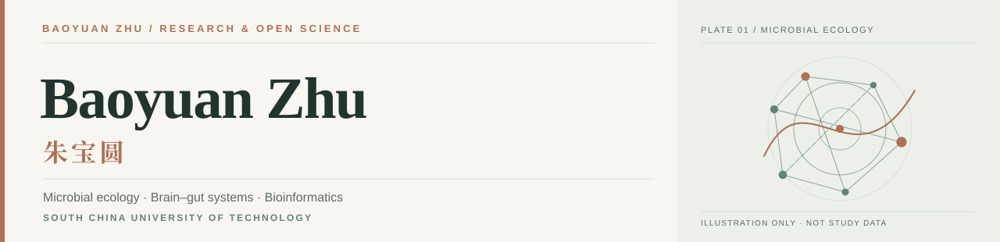

<!--
  Baoyuan Zhu / 朱宝圆 — GitHub Profile README.
  Bilingual editorial profile. Designed for the native GitHub Overview.
  The light/dark illustrations are decorative abstractions, not study results.
-->

  <picture>
    <source media="(prefers-color-scheme: dark)" srcset="./assets/cover-dark.svg">
    <source media="(prefers-color-scheme: light)" srcset="./assets/cover-light.svg">
    
  </picture>

  <a href="https://zbyloveyj.github.io/"><strong>Academic Website ↗</strong></a>
  &nbsp; · &nbsp;
  <a href="https://zbyloveyj.github.io/research.html">Research</a>
  &nbsp; · &nbsp;
  <a href="https://zbyloveyj.github.io/publications.html">Publications</a>
  &nbsp; · &nbsp;
  <a href="https://zbyloveyj.github.io/projects.html">Projects</a>
  &nbsp; · &nbsp;
  <a href="https://zbyloveyj.github.io/assets/Baoyuan_Zhu_Academic_CV.pdf">CV</a>

## A little about me · 关于我

I'm **Baoyuan Zhu (朱宝圆)**, a PhD candidate at **South China University of Technology**. I study the ecology of human-associated microbial communities and how their variation is associated with clinical phenotypes, psychiatric heterogeneity and brain function. My work brings together metagenomics, multimodal biomedical data and interpretable computational modeling.

我是**朱宝圆**，华南理工大学博士研究生。我的研究以**微生物生态**为起点，关注肠道微生物组的群落变异如何与**精神疾病临床异质性、认知表型及脑功能**建立联系，并结合宏基因组学、多模态数据分析与可解释计算方法，探索可重复、可检验的跨尺度关联。

> **Research philosophy / 科研理念**  
> Understand the ecosystem first. Interpret associations carefully. Keep the evidence reproducible.  
> 从生态系统本身出发，谨慎解释统计关联，让每一步证据都经得起复核。

## Research focus · 研究方向

| 01 · Microbial ecology | 02 · Brain–gut systems |
| :--- | :--- |
| **Ecological structure across populations** — continuous microbial factors, cross-cohort comparison and health-reference modeling. 全球微生物生态结构与连续因子 | **Clinical and neural heterogeneity** — psychiatric symptoms, cognitive dimensions, neuroimaging and microbial–clinical axes. 精神疾病异质性与脑肠关联 |
| **03 · Microbial genetics** — strain variation, mobile genetic elements and functional diversity. 微生物遗传变异与功能解析 | **04 · Interpretable AI** — multimodal learning, robust validation and research-oriented computational tools. 可解释人工智能与跨尺度整合 |

## Selected work · 代表性成果

<table>
  <tr>
    <td width="100" valign="top"><strong>2026</strong> Advanced Science</td>
    <td><a href="https://doi.org/10.1002/advs.202517087"><strong>Dissecting the Ecological Structure of Health and Disease in the Global Gut Microbiome</strong></a> 20,178 metagenomes · 36 countries · ecological factor modeling</td>
  </tr>
  <tr>
    <td valign="top"><strong>2026</strong> Research</td>
    <td><a href="https://doi.org/10.34133/research.1142"><strong>The Brain–Gut Health Initiative (BIGHI): A Prospective Cohort on Psychiatric Disorders in China</strong></a> Prospective multimodal research infrastructure for psychiatric brain–gut studies</td>
  </tr>
  <tr>
    <td valign="top"><strong>2026</strong> J. Affective Disorders</td>
    <td><a href="https://doi.org/10.1016/j.jad.2026.121858"><strong>Integrative multi-kingdom gut microbiome analysis uncovers clinical signatures of major depressive disorder</strong></a> Beyond bacterial profiling · multi-kingdom variation and clinical characteristics</td>
  </tr>
  <tr>
    <td valign="top"><strong>2025</strong> Transl. Psychiatry</td>
    <td><a href="https://doi.org/10.1038/s41398-025-03449-6"><strong>Multi-kingdom microbial changes and their associations with the clinical characteristics in schizophrenia patients</strong></a> Clinical heterogeneity · multi-kingdom metagenomics</td>
  </tr>
</table>

<a href="https://zbyloveyj.github.io/publications.html"><strong>Browse selected publications & citations →</strong></a>

## Code & open science · 研究代码

| Project | What it explores |
| :--- | :--- |
| [**Microbial Ecological Factors**](https://github.com/zbyloveyj/SCUT_Minilab_MEF) | Continuous ecological factor modeling · 微生物生态因子 |
| [**CLEAR-Microbiome**](https://github.com/zbyloveyj/CLEAR-Microbiome) | Contrastive microbiome–clinical representation learning · 微生物—临床对比学习 |
| [**Normative Microbial Networks**](https://github.com/zbyloveyj/Normative-Microbial-Network-Modeling-Framework) | Healthy-reference ecological modeling · 规范生态网络 |
| [**BioAgentLab**](https://github.com/zbyloveyj/BioAgentLab) | Evidence-aware AI agents & open education · 科研智能体与教学 |

Research prototypes, analysis code and educational projects have different validation scopes. See each repository for its limitations.

## Beyond the lab · 科研之外

I also write about science and research practice, including [*The Invisible Civilization*](https://zbyloveyj.github.io/invisible-civilization/), a science-history novel, and [*A Researcher's Field Guide*](https://zbyloveyj.github.io/graduate-research-handbook/), an evolving handbook for early-career researchers.

科研之外，我喜欢**阅读、科学写作与知识分享**，也很珍惜**和对象一起的日常生活**。学术研究是我生活中重要的一部分，但不是全部。

---

  <a href="mailto:18851970329@163.com">Email</a>
  &nbsp; · &nbsp;
  <a href="https://orcid.org/0009-0006-6213-214X">ORCID</a>
  &nbsp; · &nbsp;
  <a href="https://github.com/zbyloveyj">GitHub</a>
  &nbsp; · &nbsp;
  <a href="https://zbyloveyj.github.io/">Personal website</a>
   
  Baoyuan Zhu · Research · Code · Writing | Updated October 2026

